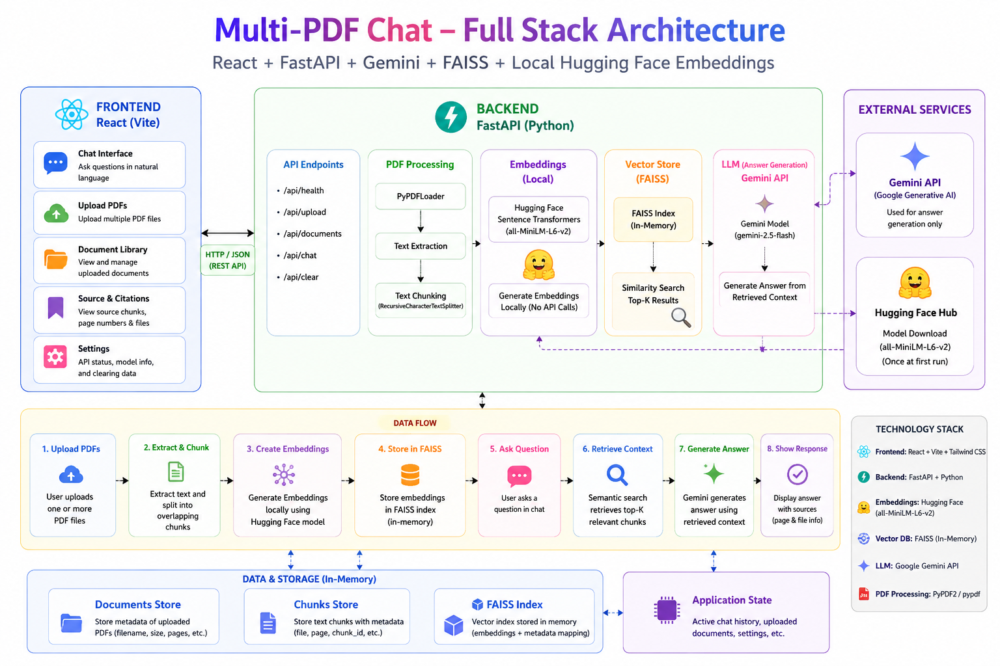

# Multi-PDF Chat

Ask questions across multiple uploaded PDFs using a React frontend, FastAPI backend, Gemini for answer generation, Sentence Transformers for local embeddings, and FAISS for similarity search.


## Requirements
- Python 3.10+
- Node.js 18+
- A Gemini API key

## Run the backend (Windows PowerShell)
```powershell
cd multi_pdf_chat\backend
python -m venv .venv
.\.venv\Scripts\Activate.ps1
pip install -r requirements.txt
Copy-Item .env.example .env
# Edit backend\.env and set GEMINI_API_KEY
uvicorn app.main:app --reload --host 127.0.0.1 --port 8000
```

## Run the frontend (second terminal)
```powershell
cd multi_pdf_chat\frontend
npm install
npm run dev
```
Open the Vite URL printed in the terminal (normally http://localhost:5173).

## Features
- Upload multiple PDFs in one batch or add more later.
- Ask questions across all indexed PDFs.
- Answers include source filename and page number where available.
- Remove uploaded documents from the current session.
- Per-file upload limit: 25 MB.
- PDF text is extracted with PyMuPDF. Scanned/image-only PDFs need OCR first.
- Documents and the FAISS index are stored in memory and are cleared when the backend restarts.

## Configuration
Backend `.env`:
```env
GEMINI_API_KEY=your_gemini_api_key
GEMINI_MODEL=gemini-2.5-flash
FRONTEND_ORIGIN=http://localhost:5173
```

This starter is intended for local development. For production, add persistent storage, authentication, upload scanning, rate limiting, and background indexing.
